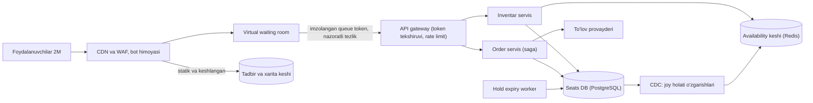
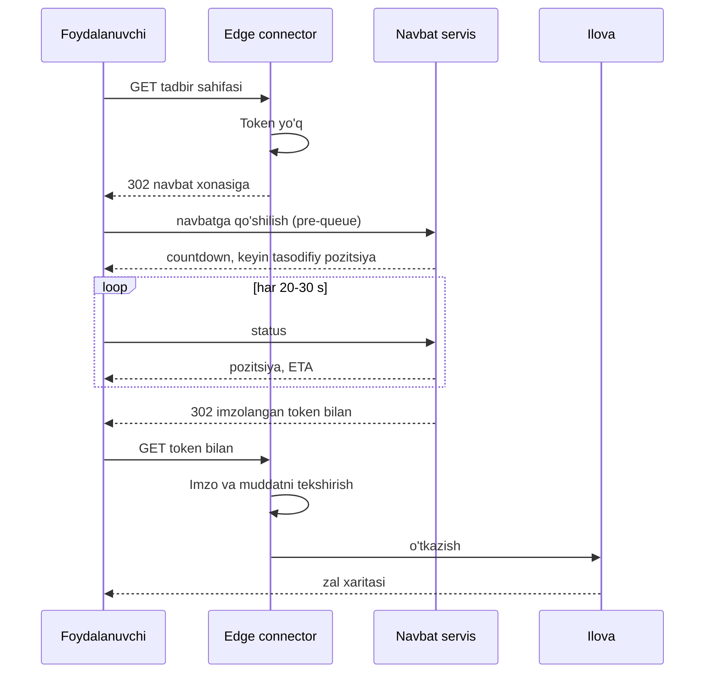
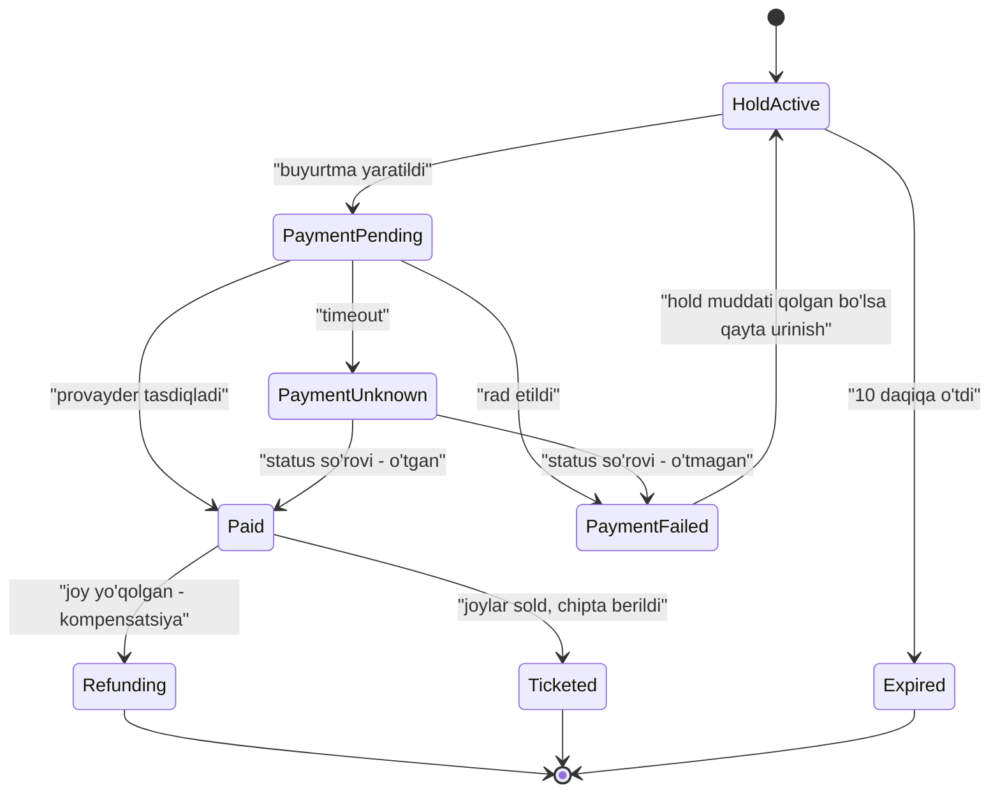

## Bu dars nima uchun kerak

Chipta sotish va flash sale - **cheklangan resurs uchun bir lahzalik ommaviy talashuv**. Konsert uchun 50 000 joy bor, sotuv soat 10:00 da ochiladi va o'sha daqiqada millionlab odam (va botlar) keladi. Talab taklifdan yuz baravar ko'p. Bu boshqa case study lardan tubdan farq qiladi: oddiy tizimlarda cho'qqi o'rtachadan 2-10 baravar katta bo'lsa, bu yerda **bir necha daqiqalik cho'qqi o'rtachadan ming baravar katta** va qolgan vaqtda tizim deyarli bo'sh.

Asosiy savollar: (1) bitta joyni ikki kishiga sotmaslik (overselling) - kuchli consistency; (2) millionlab bir vaqtdagi so'rovni tizimni yiqitmasdan qabul qilish - yuklamani shakllantirish; (3) adolat - botlar va tez internetli foydalanuvchilar ustunlik olmasligi; (4) to'lov va band qilish orasidagi vaqt.

Bu dars 18-19 darslardagi izolyatsiya va lock larni, 38-darsdagi lease ni, 56-darsdagi rate limiting ni, 63-darsdagi load shedding ni, 49-darsdagi saga ni, 88-darsdagi to'lov idempotentligini va 80-darsdagi bot himoyasini birlashtiradi.

Bu darsdan keyin siz:

- flash sale ning cho'qqi yuklamasini va "sotiladigan inventar" bilan "kelayotgan talab" orasidagi nisbatni hisoblay olasiz;
- joyni vaqtinchalik ushlab turish (hold) ni turli usullar bilan (DB lock, shartli UPDATE, Redis, oldindan bo'lingan inventar) loyihalay olasiz;
- virtual waiting room (navbat xonasi) ni loyihalay olasiz va uning adolat modelini tushuntira olasiz;
- band qilish va to'lov orasidagi saga va timeout larni loyihalay olasiz;
- Ticketmaster 2022 voqeasidan va Queue-it yondashuvidan saboq chiqara olasiz.

## 1-qadam: talablar

**Funksional talablar:**

- FR-1: tadbirlar ro'yxati va zal xaritasi (sektor, qator, joy) bilan.
- FR-2: foydalanuvchi aniq joy(lar)ni tanlaydi (yoki "eng yaxshi mavjud" tanlovi) va ular unga **10 daqiqaga ushlab turiladi** (hold).
- FR-3: hold davomida to'lov; to'lov muvaffaqiyatli bo'lsa chipta beriladi; aks holda joy qaytariladi.
- FR-4: katta sotuvlar uchun navbat xonasi (waiting room).
- FR-5: bir foydalanuvchiga chipta limiti (masalan, 4 ta).

**Ko'lamdan tashqari:** ikkilamchi bozor (qayta sotish), dinamik narx, zal xaritasi muharriri, chiptani skanerlash va kirish nazorati.

**Nofunksional talablar:**

- NFR-1: **hech qachon overselling bo'lmasligi kerak** - bitta joy bitta sotilgan chipta. Bu eng qat'iy talab.
- NFR-2: sotuv ochilgan birinchi 10 daqiqada tizim ishlashda davom etadi - millionlab foydalanuvchi bo'lsa ham; yiqilish o'rniga navbat.
- NFR-3: navbatda o'rni adolatli va shaffof (taxminiy kutish vaqti ko'rinadi).
- NFR-4: hold qilingan joy to'lovsiz 10 daqiqadan keyin avtomatik qaytadi.
- NFR-5: to'lov aynan bir marta; to'lov o'tdi, lekin chipta berilmadi holati bo'lmasligi kerak (yoki avtomatik qaytarish).
- NFR-6: botlar va skalperlar uchun imkon qadar qiyin.
- NFR-7: zal xaritasidagi mavjudlik 5-10 soniyagacha eskirishi mumkin, lekin hold qilish yakuniy tekshiruvni o'tkazadi.

NFR-1 va NFR-7 juftligi asosiy dizayn g'oyasini ko'rsatadi: **o'qish (xarita) eventual, yozish (hold) kuchli consistency**.

## 2-qadam: hisob-kitob

**Real orientir:** 2022 yil noyabrida Taylor Swift Eras Tour presale ida Ticketmaster ga ko'ra tizimga 3.5 milliard so'rov kelgan - kompaniyaning avvalgi cho'qqisidan 4 baravar ko'p; Verified Fan ga 3.5 million kishi ro'yxatdan o'tgan va 1.5 million atrofida tanlangan; Live Nation rahbariga ko'ra o'sha kuni 2 milliondan ortiq chipta sotilgan va saytga botlar bilan birga 14 million kishi kirgan. Kompaniya botlar hujumining katta hajmini ham qayd etgan. Natijada umumiy sotuv bekor qilingan.

Boshqa orientir: Alibaba Singles Day 2020 da (TechRadar xabariga ko'ra, sotuv boshlanganidan 30 daqiqa o'tib) cho'qqi **sekundiga 583 000 buyurtma**ga yetgan.

**Hisob uchun shartlar** (bizning stsenariy, masala sharti):

| Parametr | Qiymat |
|---|---|
| Tadbir | bitta stadion konserti, 60 000 joy |
| Sotuv ochilishida | 2 million foydalanuvchi |
| Navbatsiz xatti-harakat | har foydalanuvchi sekundiga 1 so'rov |
| O'rtacha buyurtma | 2.5 joy |
| Sotib bo'linish vaqti | 15-30 daqiqa |
| Ichkaridagi faol foydalanuvchilar | 5 000 |
| Joy tanlash vaqti | 3 daqiqa; ichkarida jami 5 daqiqa |
| Hold muddati va to'lanmaslik | 10 daqiqa, 30% i to'lanmaydi |

**Talab va taklif:** 2 000 000 / 60 000 ≈ **33 baravar** ortiqcha talab. Har foydalanuvchi bitta joy olsa ham 1 - 60 000 / 2 000 000 = 97% i chiptasiz qoladi - dizayn ularga tez va halol "yo'q" deyishi kerak.

**So'rovlar:** agar navbat bo'lmasa, shartga ko'ra har foydalanuvchi sahifani yangilab, sekundiga 1 so'rov yuboradi: **2 million so'rov/s** - va bularning aksariyati zal xaritasi va hold so'rovlari. Bu dinamik, kuchli consistency li yozish yo'li uchun qabul qilib bo'lmaydigan yuklama.

**Hold operatsiyalari:** 60 000 joy / 2.5 = 24 000 muvaffaqiyatli buyurtma. Shartga ko'ra joylar 15-30 daqiqada sotilib ketadi; ichkarida (navbatdan keyin) bir vaqtda 5 000 foydalanuvchi va har biri 3 daqiqada tanlaydi: 5 000 / 180 ≈ **28 hold/s** - bu oddiy PostgreSQL uchun arzimas yuklama. Hatto 10 baravar (280/s) ham.

**Asosiy xulosa:** muammo inventar bazasida emas, **kirishda**. 60 000 joyni sotish uchun sekundiga bir necha o'nlab yozuv yetarli; qolgan barcha murakkablik - 2 million so'rov/s ni shu o'nlab yozuvga aylantirib beradigan "voronka". Shuning uchun dizayn markazida navbat xonasi turadi.

**Hold muddati va aylanish:** shartga ko'ra hold lar 10 daqiqa va ularning 30% i to'lanmaydi: 60 000 × 0.3 = 18 000 joy bir marta qayta aylanadi - sotuv davomiyligi uzayadi. Qisqa hold (5 daqiqa) aylanishni tezlashtiradi, lekin to'lovni tugatishga ulgurmaganlar ko'payadi.

**Navbat chiqish tezligi (outflow):** ichkaridagi faol foydalanuvchilar sonini 5 000 da ushlash uchun, har biri o'rtacha 5 daqiqa ichkarida bo'lsa (Little qonuni, 3-dars): λ = L / W = 5 000 / 300 s ≈ **17 foydalanuvchi/s** yoki 1 000/daqiqa. 2 million navbatni shu tezlikda o'tkazish 2 000 000 / 1 000 = 2 000 daqiqa ≈ 33 soat oladi - lekin joylar 30 daqiqada tugaydi. Demak navbat oldi qismini o'tkazgandan keyin qolganlarga "sotuv tugadi" deb e'lon qilish va ularni ichkariga kiritmaslik kerak.

## 3-qadam: API

```
GET  /v1/events/{eventId}                       -> metadata (CDN, kesh)
GET  /v1/events/{eventId}/availability          -> sektorlar bo'yicha mavjud joylar (kesh, 5 s)
GET  /v1/events/{eventId}/seats?section=A12     -> joylar holati (kesh, 2-5 s)

// Faqat navbatdan o'tgan va tokeni bor foydalanuvchilar uchun:
POST /v1/holds   Authorization, X-Queue-Token, Idempotency-Key
     { eventId, seatIds: ["A12-5-14","A12-5-15"] }
  -> 201 { holdId, expiresAt }
  -> 409 { unavailable: ["A12-5-15"] }

POST /v1/orders  Idempotency-Key  { holdId, paymentMethod }
  -> 202 { orderId, status: "payment_pending" }
GET  /v1/orders/{orderId}
DELETE /v1/holds/{holdId}                         -- foydalanuvchi o'zi bekor qildi

// Navbat
GET  /queue/{eventId}/status   Cookie: queue_id  -> { position, etaMinutes, state }
```

- **X-Queue-Token** - navbatdan o'tganlikni isbotlovchi imzolangan, muddatli token. Hold API faqat token bilan ishlaydi - navbatni chetlab o'tib to'g'ridan-to'g'ri API ga hujum qilib bo'lmaydi.
- **Idempotency-Key** hold va order da (9, 39-darslar): foydalanuvchi "Sotib olish" tugmasini 5 marta bosadi - bitta to'lov bo'lishi kerak.
- **409 ichida aniq ro'yxat** - mijoz qaysi joy band bo'lganini biladi va boshqasini tanlaydi.

## 4-qadam: ma'lumot modeli

```sql
CREATE TABLE seats (
  event_id    bigint,
  seat_id     text,            -- 'A12-5-14'
  section     text,
  price_tier  smallint,
  status      text NOT NULL,   -- 'available' | 'held' | 'sold'
  hold_id     uuid,
  hold_until  timestamptz,
  order_id    uuid,
  version     int NOT NULL DEFAULT 0,
  PRIMARY KEY (event_id, seat_id)
);
CREATE INDEX ON seats (event_id, section) WHERE status = 'available';

CREATE TABLE holds (
  hold_id uuid PRIMARY KEY, event_id bigint, user_id bigint,
  seat_ids text[], expires_at timestamptz, status text   -- active | converted | expired | released
);

CREATE TABLE orders (
  order_id uuid PRIMARY KEY, hold_id uuid UNIQUE, user_id bigint,
  amount numeric, status text,      -- payment_pending | paid | failed | refunded
  payment_idempotency_key text UNIQUE
);
```

- `seats` - **haqiqat manbai**. Har joy bitta qator. 60 000 qator - kichik jadval, to'liq xotirada.
- `holds.hold_id` - `orders.hold_id UNIQUE` orqali bitta hold bitta buyurtmaga aylanadi.
- `event_id` bo'yicha partition yoki shard - tadbirlar bir-biridan mustaqil (28-dars). Katta tadbir bitta shardga tushadi, lekin hisob-kitob bo'yicha bu muammo emas.

## 5-qadam: yuqori darajadagi arxitektura



Uchta qatlam:

1. **Kirish va voronka:** CDN (statik kontent, tadbir sahifasi), WAF va bot himoyasi (80-dars), virtual waiting room - ichkariga kiritish tezligini nazorat qiladi.
2. **Tranzaksion yadro:** inventar servis (hold), order servis (to'lov saga si), seats DB - kuchli consistency.
3. **O'qish yo'li:** availability keshi CDC (48-dars) orqali bazadan yangilanadi; xarita undan o'qiladi va 2-5 soniya eskirishi mumkin (NFR-7).

## 6-qadam: chuqur tahlil

Eng xavfli uch qism: (1) overselling siz hold, (2) virtual waiting room, (3) hold va to'lov saga si.

### 6.1. Joyni ushlab turish: overselling siz

Ikki foydalanuvchi bir vaqtda A12-5-14 ni tanladi. Faqat bittasi muvaffaqiyatli bo'lishi kerak. To'rt yondashuv:

**A. Pessimistik lock (SELECT ... FOR UPDATE).**

```sql
BEGIN;
SELECT * FROM seats WHERE event_id = $1 AND seat_id = ANY($2) FOR UPDATE;
-- ilovada: hammasi available yoki hold muddati o'tganmi?
UPDATE seats SET status='held', hold_id=$3, hold_until=now()+interval '10 min' WHERE ...;
COMMIT;
```

To'g'ri, lekin talashuvda ikkinchi tranzaksiya birinchisini **kutadi**. Mashhur joylarda (old qatorlar) navbat paydo bo'ladi. Ko'p joyli buyurtmalarda deadlock xavfi (joylarni har doim bir xil tartibda lock qilish kerak). `FOR UPDATE NOWAIT` kutish o'rniga darhol xato beradi - foydalanuvchiga "bu joy hozirgina band bo'ldi" deyish uchun yaxshiroq.

**B. Shartli UPDATE (optimistik, atomik).**

```sql
UPDATE seats
   SET status = 'held', hold_id = $3, hold_until = now() + interval '10 minutes',
       version = version + 1
 WHERE event_id = $1 AND seat_id = ANY($2)
   AND (status = 'available' OR (status = 'held' AND hold_until < now()))
RETURNING seat_id;
```

Agar qaytgan qatorlar soni so'ralgan joylar sonidan kam bo'lsa - tranzaksiyani ROLLBACK qilib, 409 qaytarish (hammasi yoki hech biri). Bitta statement - bitta tranzaksiya, kutish minimal, deadlock xavfi kam (joylar bitta UPDATE da). Muddati o'tgan hold larni ham shu yerda "qayta oladi" - expiry worker kechiksa ham joy yo'qolmaydi. PostgreSQL hujjatining "Transaction Isolation" bo'limiga (13.2.1, Read Committed) ko'ra: UPDATE topgan qatorni boshqa parallel tranzaksiya allaqachon o'zgartirgan bo'lsa, ikkinchi UPDATE birinchisi commit yoki rollback bo'lishini kutadi; birinchisi commit bo'lsa, ikkinchisi WHERE shartini **qatorning yangilangan versiyasida qayta tekshiradi** va shart hali mos kelsagina o'zgartiradi. Shuning uchun ikkinchisi `status = 'held'` ni ko'rib, qatorni o'zgartirmaydi (18-19 darslar). Bu NFR-1 ni oddiy va ishonchli bajaradi.

**C. Redis da hold (SET NX PX).**

```
SET hold:{eventId}:{seatId} {holdId} NX PX 600000
```

Juda tez, TTL avtomatik qaytarishni beradi. Lekin: Redis haqiqat manbai bo'lsa, failover da async replication tufayli oxirgi hold lar yo'qolishi mumkin - va ikkinchi foydalanuvchi o'sha joyni ushlaydi; Kleppmann ning Redlock tanqidida ko'rsatilganidek, jarayon pauzasi va soat muammolari tufayli lock xavfsizligi kafolatlanmaydi, agar yakuniy resurs fencing token ni tekshirmasa (38-dars). Shuning uchun Redis faqat **oldindagi tez filtr** sifatida mos: avval Redis da SET NX (talashuvni tez kesadi), keyin bazada B variantidagi shartli UPDATE (haqiqat). Ikki qatlam bo'lsa ham, yakuniy sotuv bazada.

**D. Oldindan bo'lingan inventar / tokenlar.** Joy tanlanmaydigan sotuvlarda ("Sektor A, istalgan joy" yoki flash sale da 10 000 dona mahsulot): inventar oldindan N ta "token" ga bo'linib, navbatga (yoki Redis ro'yxatiga) qo'yiladi; har sotib oluvchi `LPOP` bilan bitta token oladi. Konkurentlik muammosi butunlay yo'qoladi - talashuv bitta atomik pop ga aylanadi. Bitta hisoblagich (`DECR stock`) hot key bo'lsa, inventarni bir nechta "chelak" ga bo'lish (masalan, 10 ta kalit, har birida 1 000 dona).

| Usul | Overselling himoyasi | Talashuvdagi latency | Murakkablik | Qachon |
|---|---|---|---|---|
| FOR UPDATE | Kuchli | Kutish, deadlock xavfi | O'rta | Kam talashuv |
| Shartli UPDATE | Kuchli | Past, kutish qisqa | Past | Aniq joylar - asosiy tanlov |
| Redis SET NX | Zaif (failover) | Juda past | O'rta | Faqat old filtr |
| Oldindan tokenlar | Kuchli (atomik pop) | Juda past | O'rta | Joy tanlanmaydigan sotuv |

**Tanlov:** aniq joylar uchun **B (shartli UPDATE)** haqiqat manbai sifatida; mashhur sektorlarda talashuvni kamaytirish uchun ixtiyoriy Redis old filtri; joy tanlanmaydigan sotuvlar uchun D.

**Hold expiry.** `hold_until` maydoni tufayli muddati o'tgan joy B shartida avtomatik "bo'sh" hisoblanadi. Fon worker i har 10-30 soniyada `UPDATE seats SET status='available' WHERE status='held' AND hold_until < now()` qiladi - bu faqat xarita keshini toza ushlash uchun, to'g'rilik uchun emas.

### 6.2. Virtual waiting room

Hisob-kitob ko'rsatdiki, muammo - kirishda. Virtual waiting room tizim oldiga qo'yilgan **yuklamani shakllantiruvchi navbat** (63-dars: load shedding ning "yumshoq" varianti - so'rovni rad etish o'rniga kuttirish).

**Ishlash tartibi (Queue-it ning "How Queue-it works" developer hujjati asosida; 302 oqimi connector ning v4 va undan oldingi versiyalari uchun tasvirlangan):**

1. Himoyalangan URL ga so'rov keladi; connector (edge da yoki ilovada) foydalanuvchida haqiqiy navbat tokeni bormi tekshiradi.
2. Token bo'lmasa - HTTP 302 bilan navbat xonasiga yo'naltirish.
3. Navbat foydalanuvchini sozlangan tezlikda (outflow) qaytaradi - imzolangan token bilan.
4. Token bilan qaytgan foydalanuvchi himoyalangan sahifaga o'tadi.

**Adolat modeli.** Sof FIFO da "sotuv navbat ochilgan paytda boshlanadi": birinchi bo'lib kelgan - eng tez internetli yoki bot. Queue-it ning yondashuvi:

- Sotuv boshlanishidan **oldin** kelganlar "pre-queue" ga tushadi - countdown ko'radi, lekin o'rin olmaydi.
- Sotuv boshlanganda pre-queue dagilar **tasodifiy tartib** bilan joylashtiriladi (lotereya kabi) - o'z vaqtida kelgan har kimning imkoniyati teng.
- Sotuv boshlangandan **keyin** kelganlar navbat oxiriga FIFO bilan qo'shiladi - o'z vaqtida kelganlardan oldinga o'tolmaydi.

Bu bot va tez ulanish ustunligini sezilarli kamaytiradi: millisekundlarda kelish endi ahamiyatsiz.

**Arxitektura:**



**Nima uchun navbat servisi o'zi yiqilmaydi:** u juda oddiy holatni saqlaydi (foydalanuvchi ID va pozitsiya), status so'rovlari keshlanadi va statik sahifalar CDN dan. Har foydalanuvchiga tasodifiy pozitsiya berish - bitta atomik hisoblagich yoki oldindan aralashtirilgan ro'yxat. Status polling intervali 20-30 s (shart) bilan: 2 000 000 / 30 ≈ 67 000 dan 2 000 000 / 20 = 100 000 gacha so'rov/s - bu keshlangan, oddiy javob, ilova yadrosiga tegmaydi.

**Token:** HMAC bilan imzolangan `{eventId, userId/sessionId, issuedAt, expiresAt}`. Edge da tekshiriladi - bazaga murojaat yo'q. Muddat qisqa (masalan, 15-30 daqiqa) va bitta sessiyaga bog'langan - tokenni ulashish yoki sotish foyda bermasligi uchun.

**Outflow tezligini boshqarish:** statik raqam emas, **ichkaridagi holatga qarab**: agar inventar servis p99 latency oshsa yoki ichkaridagi faol sessiyalar chegaradan oshsa - tezlikni kamaytirish (closed-loop, 76-dars). Joylar tugaganda navbatdagilarga darhol "sotuv tugadi" xabari - ular soatlab kutib qolmasligi kerak.

**Navbat ichidagi pre-validatsiya:** navbatda turgan vaqtni bot tekshiruvi (CAPTCHA, qurilma signallari) va hisob tekshiruvi uchun ishlatish - ichkariga faqat tekshirilganlar kiradi. Ticketmaster ning Verified Fan dasturi shu g'oyani yanada oldinga suradi: sotuvdan oldin ro'yxatdan o'tish va tanlov orqali talabni boshqarish.

### 6.3. Hold va to'lov saga si

Hold dan chiptagacha bir necha qadam va tashqi to'lov provayderi bor. Bitta distributed tranzaksiya (2PC, 37-dars) bilan qilib bo'lmaydi - to'lov provayderi bunda qatnashmaydi. Saga (49-dars, orchestration):



Nozik joylar:

1. **To'lov hold muddati tugashiga yaqin boshlansa.** Foydalanuvchi 9:58 da to'lov bosdi, provayder 30 soniya oladi. Hold 10:00 da tugaydi va boshqa birov joyni oladi. Keyin to'lov o'tadi - pul olingan, joy yo'q. Himoyalar: (a) buyurtma yaratilganda hold ni `payment_pending` holatiga o'tkazib, muddatini to'lov timeout iga uzaytirish (masalan, +3 daqiqa); (b) shartli UPDATE dagi `hold_until < now()` sharti `payment_pending` joylarga tegmasligi; (c) baribir kompensatsiya: `Paid → Refunding` - joy yo'qolgan bo'lsa avtomatik qaytarish.
2. **To'lov natijasi noma'lum (timeout).** Provayder javob bermadi. Qayta yuborish ikki marta to'lov xavfini tug'diradi. Shuning uchun provayderga har doim **idempotency kaliti** (`order_id`) bilan so'rov (88-dars) va timeout dan keyin qayta yuborish emas, **status so'rovi**.
3. **Paid → Ticketed atomik bo'lishi kerak:** `UPDATE seats SET status='sold', order_id=$1 WHERE hold_id=$2 AND status='held'` va `orders.status='paid'` bitta lokal tranzaksiyada; chipta yaratish (PDF, QR, email) - outbox orqali asinxron (48-dars).
4. **Foydalanuvchi limiti (FR-5):** "bir kishiga 4 chipta" - hold yaratishda `user_id` bo'yicha faol hold va sotilgan joylar sonini tekshirish; bir nechta parallel sessiya bilan aylanib o'tishga qarshi - foydalanuvchi bo'yicha qisqa lock yoki `holds` ga `(event_id, user_id)` bo'yicha qisman noyob indeks (faqat aktiv hold lar uchun).

## 7-qadam: nosozlik stsenariylari

| Stsenariy | Ta'sir | Himoya |
|---|---|---|
| Navbatsiz to'g'ridan-to'g'ri API ga hujum | Yadro yiqiladi | Hold API faqat imzolangan token bilan; edge da rate limit (56-dars) |
| Botlar navbatda millionlab o'rin egallaydi | Haqiqiy foydalanuvchilar chiqib ketadi | Pre-queue randomizatsiya, bot aniqlash, Verified Fan uslubidagi oldindan ro'yxat |
| Seats DB primary o'ldi | Hold va sotuv to'xtaydi | Sinxron replica ga failover (26-dars) - RPO 0 kerak, chunki sotilgan joy yo'qolmasligi shart; navbat outflow avtomatik to'xtaydi |
| Availability keshi eskirdi | Xaritada band joy bo'sh ko'rinadi | Hold da yakuniy tekshiruv, 409 va yangilangan xarita |
| To'lov provayderi sekinlashdi | Hold lar to'lovda qotib qoladi | Timeout, circuit breaker (63-dars), payment_pending holatida hold uzaytirilgan; navbat tezligini kamaytirish |
| Expiry worker o'ldi | Muddati o'tgan hold lar xaritada band | Shartli UPDATE muddati o'tganlarni baribir qayta oladi - to'g'rilik buzilmaydi |
| Foydalanuvchi "Sotib olish" ni ko'p bosdi | Ko'p buyurtma | Idempotency-Key va hold_id UNIQUE |
| Butun region o'ldi | Sotuv to'xtaydi | Sotuvni to'xtatish va keyin qayta ochish ma'lumot yo'qotishdan yaxshiroq; multi-region active-active inventar - overselling xavfi |

Oxirgi qatordagi qaror muhim: chipta sotish uchun **CAP da consistency tanlanadi** (34-dars). Region bo'linsa, ikkala tomonda sotishga ruxsat berish overselling ga olib keladi. Shuning uchun bitta tadbir inventari bitta regionda (bitta leader) - mavjudlik buning narxi.

## 8-qadam: evolyutsiya (10x)

10x: 20 million bir vaqtdagi foydalanuvchi bitta tadbirga (Eras Tour darajasi) yoki bir vaqtda o'nlab katta sotuv.

1. **Birinchi sinadigan - navbatning o'zi va edge.** 20 million status polling, bot trafigi. Navbat holatini edge ga yaqin (CDN worker lari, edge KV), statusni push (SSE) yoki uzunroq polling intervali bilan.
2. **Inventar yadrosi hali ham kichik** - 60 000 joy uchun sekundiga yuzlab hold. Lekin bir vaqtda 50 ta tadbir bo'lsa - event_id bo'yicha sharding.
3. **To'lov** - provayder limitlari asosiy cheklov bo'lishi mumkin; bir nechta provayder va ularning rate limit lariga mos outflow.
4. **Talabni sotuvdan oldin boshqarish** - Verified Fan kabi oldindan ro'yxatdan o'tish va tanlov: real talabni oldindan bilish va kiruvchi oqimni sotuvdan oldin kamaytirish. Bu texnik emas, mahsulot yechimi - va eng samaralisi.

## iQuariX kontekstida

Masala sharti (o'quv ssenariysi): iQuariX ning SOS/xizmat marketpleysida (yoki texnik xizmat ko'rsatish markazlari bilan integratsiyada) **cheklangan slotlarni band qilish** kerak: servis markazida kuniga 40 ta texnik ko'rik sloti, mijoz kompaniyalar o'z mashinalari uchun slot band qiladi; oy boshida (yoki aksiya paytida) talab keskin oshadi.

- Bu "kichik Ticketmaster": slot = joy. **Shartli UPDATE** (6.1 B) bilan `slots` jadvali va hold muddati (masalan, 5 daqiqa tasdiqlash uchun) - overselling siz.
- Navbat xonasi kerak emas - talab yuzlab, millionlab emas. Lekin **adolat** savoli bor: bitta katta mijoz barcha slotlarni band qilib olmasligi uchun tenant bo'yicha limit (FR-5 ning analogi).
- To'lov keyin (shartnoma bo'yicha) bo'lsa, saga soddalashadi: hold → tasdiqlash → band. Lekin "mashina kelmadi" holati uchun bekor qilish siyosati va slotni qaytarish.
- Hold expiry ni `hold_until` bilan shartli UPDATE ichida tekshirish - fon worker i to'xtasa ham to'g'rilik saqlanadi.

## Ko'p uchraydigan xatolar

1. **"Avval o'qi, keyin yoz" ni lock siz qilish.** `SELECT status` → ilovada tekshirish → `UPDATE` - ikki parallel so'rov ikkalasi ham "available" ko'radi. Atomik shartli UPDATE kerak.
2. **Redis ni yakuniy haqiqat manbai qilish.** Failover da hold lar yo'qoladi va overselling bo'ladi.
3. **Navbatsiz yadroni masshtablashga urinish.** 2 million so'rov/s ni tranzaksion yadroga yo'naltirish - yadroni emas, kirishni loyihalash kerak.
4. **Sof FIFO navbat.** Botlar va tez ulanishlar yutadi; pre-queue randomizatsiya kerak.
5. **Navbat tokenini tekshirmaydigan API.** Botlar navbatni chetlab o'tadi.
6. **To'lov timeout ida qayta yuborish.** Ikki marta yechish; status so'rovi va idempotency kaliti kerak.
7. **Hold muddati va to'lov davomiyligini muvofiqlashtirmaslik.** "Pul olindi, joy yo'q" - kompensatsiya oqimi va hold uzaytirish kerak.
8. **Sotuv tugaganini navbatdagilarga aytmaslik.** Millionlab odam soatlab behuda kutadi va ishonch yo'qoladi.

## Xulosa

- Flash sale - bir necha daqiqalik, o'rtachadan ming baravar katta cho'qqi; talab taklifdan o'nlab baravar ko'p.
- Inventar yadrosi kichik (sekundiga o'nlab-yuzlab hold), muammo - kirish; virtual waiting room 2 million so'rov/s ni boshqariladigan oqimga aylantiradi.
- Overselling ga qarshi asosiy vosita - bazadagi atomik shartli UPDATE (hammasi yoki hech biri), muddati o'tgan hold larni ham qayta oladigan shart bilan.
- Redis faqat old filtr; joy tanlanmaydigan sotuvlarda oldindan bo'lingan tokenlar.
- Adolat: pre-queue randomizatsiya, keyin FIFO; imzolangan, muddatli navbat tokeni edge da tekshiriladi.
- Hold va to'lov - saga: idempotency kaliti, timeout da status so'rovi, payment_pending da hold uzaytirish, kompensatsiya.
- Region bo'linishida consistency tanlanadi: bitta tadbir inventari bitta leader da.

## Amaliy topshiriq

iQuariX uchun **"aksiya: GPS treker o'rnatish uchun cheklangan chegirmali slotlar"** tizimini loyihalang (faraziy): oy boshida 500 ta chegirmali o'rnatish sloti (10 ta montaj punkti × 50 slot) e'lon qilinadi; 3 000 ta korporativ mijoz bir vaqtda kiradi; har mijozga ko'pi bilan 20 slot.

1. **Talablar.** FR va NFR: overselling, adolat (katta va kichik mijozlar orasida), hold muddati, tasdiqlash jarayoni.
2. **Hisob-kitob.** Talab/taklif nisbati, cho'qqi so'rov/s, hold/s. Navbat xonasi kerakmi yoki rate limit yetadimi - raqam bilan asoslang.
3. **Ma'lumot modeli va hold SQL i.** Slotlar jadvali va hold uchun atomik shartli UPDATE (bir nechta slotni hammasi yoki hech biri).
4. **Adolat.** 20 slot limiti va bitta mijozning bir nechta foydalanuvchisi parallel band qilishiga qarshi himoya.
5. **Tasdiqlash saga si.** Hold → mijoz tasdig'i (yoki avans to'lovi) → yakuniy band. Muddati o'tganda nima bo'ladi?
6. **Nosozliklar.** Baza failover, foydalanuvchi tugmani ko'p bosishi, tasdiqlash xizmati sekinlashishi.

Yaxshi javobda bo'lishi kerak bo'lgan narsalar:

- hisob-kitob asosida navbat xonasining keraksizligi yoki zarurligi asoslangan;
- hold SQL i atomik va muddati o'tgan hold larni qayta oladi;
- tenant limitining parallel so'rovlarga chidamli implementatsiyasi;
- idempotency kaliti va hold-buyurtma 1:1 bog'liqligi;
- consistency ustun ekanligi va uning narxi tan olingan.

Javobni pastdagi maydonga yozib, chatga yuboring.

## Manbalar

- [Ticketmaster cancels general sale of Taylor Swift tickets](https://www.boston.com/culture/music/2022/11/17/ticketmaster-cancels-general-sale-taylor-swift-tickets/), Boston.com, 2022 - 3.5 milliard so'rov, Verified Fan raqamlari, 14 million tashrif.
- Queue-it. [First-in, first-out vs randomization](https://www.queue-it.com/blog/first-in-first-out-randomization) - pre-queue randomizatsiya va FIFO adolat modeli.
- Queue-it. [How Queue-it works](https://www.queue-it.com/developers/how-queue-it-works/) - connector, 302 yo'naltirish, imzolangan token, outflow.
- PostgreSQL. [SELECT - The Locking Clause](https://www.postgresql.org/docs/current/sql-select.html) - FOR UPDATE, NOWAIT, SKIP LOCKED.
- PostgreSQL. [Transaction Isolation](https://www.postgresql.org/docs/current/transaction-iso.html), 13.2.1 Read Committed - kutayotgan UPDATE WHERE shartini qatorning yangilangan versiyasida qayta tekshiradi.
- Martin Kleppmann. [How to do distributed locking](https://martin.kleppmann.com/2016/02/08/how-to-do-distributed-locking.html), 2016 - Redis lock lari va fencing token cheklovlari.
- [Singles Day 2020 is already the biggest shopping event in history](https://www.techradar.com/news/singles-day-2020-is-already-the-biggest-shopping-event-in-history), TechRadar, 2020 - 583 000 buyurtma/s cho'qqi.
- Alex Xu, Sahn Lam. System Design Interview, 2-jild, 7-bob "Hotel Reservation" - band qilishdagi konkurentlik. [Boblar ro'yxati](https://system-design.space/en/chapter/system-design-interview-vol2-book).
