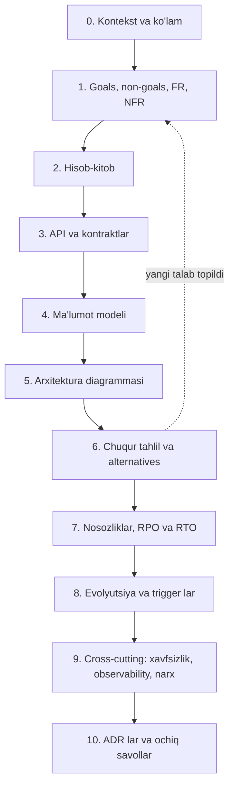

## Bu dars nima uchun kerak

99 ta darsdan keyin oxirgi qadam - bilimni **o'z tizimingizga** qo'llash. Case study larda (92-99) masalani biz tanladik va talablarni biz yozdik. Real ishda esa talablar noaniq, cheklovlar ziddiyatli, mavjud tizim va jamoa bor, va hech kim "to'g'ri javob"ni bilmaydi. Yakuniy loyihaning maqsadi - aynan shu sharoitda 8 qadamli jarayonni boshidan oxirigacha o'tib, natijani **review dan o'tadigan** design doc ko'rinishida himoya qilish.

Bu dars uchta narsani beradi:

1. **Yakuniy loyiha shartlari** - qaysi tizimni tanlash va design doc qanday tuzilishda bo'lishi.
2. **Har bir qadam uchun "tekshirish ro'yxati"** - kursning qaysi darslariga qaytib qarash kerakligi bilan.
3. **Review rubrikasi** - o'z ishingizni (yoki boshqa birovning ishini) baholash uchun ochko tizimi va tipik xatolar.

Bu darsdan keyin siz:

- o'z tizimingiz uchun to'liq design doc yoza olasiz (10-20 sahifa darajasida);
- uni 91-darsdagi freymvork bo'yicha 45-60 daqiqada taqdim eta olasiz;
- rubrika bo'yicha o'z dizayningizdagi zaif joylarni topa olasiz;
- muhim qarorlarni ADR sifatida qayd eta olasiz va ularning "qayta ko'rish trigger"larini belgilay olasiz;
- kursdagi 100 ta mavzuni qaror qabul qilish xaritasi sifatida ishlata olasiz.

## Loyiha tanlash

Uchta variant (birini tanlang):

**A. O'z mahsulotingizning real moduli.** Eng qimmatli variant: natija to'g'ridan-to'g'ri ishga yaraydi. Masalan, iQuariX uchun (bu namunaviy mavzular, ularni real ma'lumotlaringiz bilan to'ldiring): "AI analitika va haydovchi skoringi pipeline i", "ichki operatsion tizim (CRM/ERP) ning montaj va ombor moduli", "video arxiv va hodisa kliplari", "SOS marketpleys moduli", "multi-region kengayish (Qozog'iston, Rossiya) va data residency".

**B. Mavjud tizimni qayta loyihalash.** Hozir ishlayotgan, lekin 10x da sinishi aniq bo'lgan qism: "monolitdagi telemetriya ingest ini ajratish", "hisobot generatsiyasini asinxron va izolyatsiyalangan qilish". Bu yerda migratsiya rejasi alohida qiyinchilik.

**C. Klassik masala, lekin yangi cheklovlar bilan.** Masalan, "Uber, lekin internet uzilishi tez-tez bo'ladigan mamlakatda" yoki "Google Docs, lekin 100% oflayn-birinchi". Bu variant chuqur tahlil ko'nikmasini mashq qilish uchun.

Tanlov mezoni: tizimda **kamida ikkita jiddiy chuqur tahlil mavzusi** bo'lishi kerak (masalan, yuqori yozish yuklamasi va kuchli consistency invarianti; yoki katta hajm va multi-tenant izolyatsiya). Faqat CRUD dan iborat tizim yakuniy loyiha uchun juda oddiy.

## Design doc tuzilmasi

91-darsdagi Google design doc tuzilmasi va 8 qadamni birlashtiramiz:

Hajm: 10-20 sahifa. Har bo'limda "**demak...**" bilan tugaydigan xulosa bo'lsin - raqam yoki fakt qaysi qarorga olib kelganini ko'rsatish uchun.

## Qadam-baqadam tekshirish ro'yxati

Har bir qadam uchun minimal natija va kursning tegishli darslari. Bu - 100 ta darsning "qaror xaritasi".

### 1. Talablar (1-dars)

- [ ] 5-8 ta FR, har biri foydalanuvchi yoki tizim amali sifatida.
- [ ] 6-10 ta NFR, har biri **metrika + chegara + sharoit** bilan.
- [ ] Non-goals: kamida 4 ta, dizaynni haqiqatan soddalashtiradigan.
- [ ] Consistency talablari har ma'lumot turi uchun alohida (33-dars): qayerda eventual yetadi, qayerda invariant bor.
- [ ] Durability: qaysi ma'lumot yo'qolishi qabul qilinmaydi va "yo'qolmaydi" qaysi nuqtadan boshlanadi (96-darsdagi ACK chegarasi kabi).
- [ ] Huquqiy cheklovlar: shaxsiy ma'lumot, data residency (78-dars).

### 2. Hisob-kitob (2-3 darslar)

- [ ] Yuklama parametrlari aniqlangan (foydalanuvchilar emas, **tizimni harakatga keltiruvchi birlik**: qurilma, hujjat, buyurtma).
- [ ] O'rtacha va cho'qqi QPS alohida; **ekstremal stsenariy** (to'lqin, flash sale, reconnect) alohida hisoblangan.
- [ ] O'qish/yozish nisbati.
- [ ] Hajm: kunlik, yillik, retention bilan; siqish va replica hisobga olingan.
- [ ] Issiq to'plam - xotiraga sig'adimi.
- [ ] Egress va oylik narx taxmini (79-dars).
- [ ] Little qonuni bilan parallellik yoki ulanishlar soni.
- [ ] Har raqamdan keyin "demak..." xulosasi.

### 3. API (8-10 darslar)

- [ ] Har tashqi chegara uchun protokol tanlovi asoslangan (REST, gRPC, WebSocket, MQTT, ishlab chiqaruvchi protokoli).
- [ ] Yozish operatsiyalari idempotent (Idempotency-Key yoki tabiiy kalit, 39-dars).
- [ ] Uzoq operatsiyalar asinxron (202 + status).
- [ ] Ro'yxatlar cursor bilan sahifalangan.
- [ ] Versiyalash va schema evolution rejasi (10-dars).

### 4. Ma'lumot modeli (11-20, 28-30 darslar)

- [ ] Asosiy so'rov shakllari ro'yxati va har biri qaysi indeks/kalit bilan bajariladi.
- [ ] Har ma'lumot turi uchun saqlash tanlovi va sababi (20-dars freymvorki).
- [ ] Partition/shard kaliti va hot partition tahlili.
- [ ] Invariantlar baza darajasida qanday ushlanadi (UNIQUE, shartli yozish, tranzaksiya, izolyatsiya darajasi - 17-19 darslar).
- [ ] Retention va arxivlash.

### 5. Arxitektura (21-25, 41-60 darslar)

- [ ] 8-12 blokli diagramma, yozish va o'qish yo'llari alohida.
- [ ] Har strelka: sinxron yoki asinxron, protokol.
- [ ] Stateful bloklar aniq ajratilgan.
- [ ] Nima uchun navbat/log bor (41-44 darslar) yoki yo'q.
- [ ] Servis chegaralari asoslangan (51-52 darslar) - monolit, modular monolit yoki servislar.

### 6. Chuqur tahlil (butun kurs)

- [ ] 2-3 mavzu: eng ko'p yuklama, eng qimmat xato, eng katta noaniqlik.
- [ ] Har birida kamida 2 ta haqiqiy alternativa va trade-off jadvali.
- [ ] Tanlov, uning narxi va "qachon qayta ko'rish kerak" sharti.
- [ ] Algoritm yoki protokol darajasidagi tafsilot (SQL, ketma-ketlik diagrammasi, holat mashinasi).

### 7. Nosozliklar (31, 61-70 darslar)

- [ ] Har stateful blok uchun: o'chish, sekinlashish, ma'lumot yo'qolishi, tiklanish.
- [ ] Takroriy xabar va tartib buzilishi (39, 43-darslar).
- [ ] Split-brain va ikki egasi xavfi (38-dars: lease, fencing).
- [ ] Cascading failure va degradatsiya rejimi (63-64 darslar).
- [ ] RPO va RTO raqamlari (69-dars).
- [ ] Suiiste'mol va xavfsizlik nosozliklari (71-74, 80-darslar).

### 8. Evolyutsiya (76-79 darslar)

- [ ] 10x da nima birinchi sinadi - tartib bilan.
- [ ] Hozir ataylab qilinmagan narsalar va ularning trigger metrikalari.
- [ ] Migratsiya yo'li (agar B variant bo'lsa): bosqichlar, har biri qaytariladigan.

### 9. Cross-cutting

- [ ] Autentifikatsiya va avtorizatsiya (71-72 darslar); multi-tenancy (73-dars).
- [ ] Shifrlash va secrets (74-dars).
- [ ] SLI va SLO (65-dars), dashboard va alert lar (66-67 darslar).
- [ ] Deploy strategiyasi (68-dars).
- [ ] Oylik narx taxmini va asosiy xarajat moddasi.

### 10. ADR va ochiq savollar

- [ ] 3-5 ta ADR (Nygard formati) eng qaytarilmaydigan qarorlar uchun.
- [ ] Ochiq savollar ro'yxati - nimani bilmaysiz va qanday aniqlaysiz.

## Review rubrikasi

Har o'q 0-4 ball. Jami 40 ball. **28+** - review dan o'tadigan dizayn; **34+** - kuchli senior/arxitektor darajasi.

| O'q | 0-1 | 2 | 3 | 4 |
|---|---|---|---|---|
| 1. Talablar | NFR noaniq, non-goals yo'q | NFR qisman raqamli | Hammasi raqamli, non-goals bor | + consistency va durability har ma'lumot turi uchun aniq |
| 2. Hisob-kitob | Yo'q yoki qarorlarga bog'lanmagan | O'rtacha QPS va hajm | + cho'qqi, issiq to'plam, narx | + ekstremal stsenariy va har raqamdan xulosa |
| 3. API | Faqat endpoint nomlari | Payload va status kodlar | + idempotency, asinxron, pagination | + versiyalash va tashqi protokol cheklovlari |
| 4. Ma'lumot modeli | Jadvallar ro'yxati | So'rovlar bilan bog'langan | + partition kaliti va hot spot | + invariantlar baza darajasida, retention |
| 5. Arxitektura | Texnologiyalar ro'yxati | Bloklar va strelkalar | + yozish/o'qish yo'llari, sync/async | Har blok talab yoki raqam bilan asoslangan |
| 6. Chuqur tahlil | Yo'q yoki yuzaki | 1 mavzu, alternativasiz | 2-3 mavzu, alternativalar bilan | + algoritm darajasi va qayta ko'rish shartlari |
| 7. Nosozliklar | "Replica qo'yamiz" | O'chish stsenariylari | + sekinlashish, dublikat, split-brain | + RPO/RTO va degradatsiya rejimlari |
| 8. Evolyutsiya | "Kubernetes bilan masshtablanadi" | 10x ro'yxati | Tartib bilan, birinchi sinadigan aniq | + trigger metrikalari va YAGNI qarorlari |
| 9. Cross-cutting | Yo'q | Xavfsizlik tilga olingan | + SLO, observability, narx | + multi-tenant izolyatsiya va deploy |
| 10. Muloqot va hujjat | Tuzilmasiz | O'qiladi | ADR lar, aniq xulosalar | Boshqa jamoa doc ni o'qib, savolsiz quradi |

### Avtomatik "qizil bayroqlar"

Bularning har biri mavjud bo'lsa, umumiy balldan qat'i nazar dizayn qayta ishlashga qaytariladi:

1. Kuchli invariant (pul, inventar, "bitta egasi") eventual consistency li komponentga tayanadi.
2. Durability chegarasi aniq emas: "qabul qilindi" javobi ma'lumot bardoshli saqlanishidan oldin beriladi.
3. Sinxron chaqiruvlar zanjiri 4 tadan uzun va timeout/circuit breaker yo'q.
4. Tenant izolyatsiyasi faqat ilova kodidagi `WHERE tenant_id` ga tayanadi va test/qo'shimcha qatlam yo'q.
5. Hisob-kitobda cho'qqi yuklama yo'q, faqat o'rtacha.
6. Bitta yozish yo'lida SPOF va uning nosozligi muhokama qilinmagan.

## Namunaviy mini-loyiha: qisqa ko'rinish

Rubrikani amalda ko'rsatish uchun juda qisqa namuna. Masala sharti: mavzu - iQuariX uchun **"haydovchi skoringi"**: har haydovchiga kunlik ball (keskin tormoz, tezlanish, tezlik oshirish, telefon ishlatish kamera orqali) va oylik reyting.

**Talablar (qisqartirilgan):** FR - kunlik ball, sabablar bilan; oylik reyting tenant ichida; dispetcher hodisani video klip bilan ko'radi. NFR - kunlik ball ertasi kuni soat 07:00 gacha tayyor; ball hisoblash formulasi versiyalangan va qayta hisoblanadi (formula o'zgarsa); bitta tenant formulasini boshqasiga ta'sirsiz sozlaydi. Non-goals - real-time ball, haydovchi mobil ilovasi, ish haqiga integratsiya.

**Hisob-kitob** (shartlar: 96-darsdagi 100 000 qurilma va kuniga 345 million nuqta; har mashinaga kuniga 20 ta hodisa): hodisalar (keskin tormoz va h.k.) 100 000 × 20 = 2 million hodisa/kun - kichik. Demak: hodisalarni aniqlash stream da (96-darsdagi qoidalar dvigateli), ballni hisoblash esa **batch** (58-dars) - kuniga bir marta, agregatlardan. Bu "real-time kerak emas" non-goal ning to'g'ridan-to'g'ri foydasi.

**Chuqur tahlil mavzulari:** (1) formula versiyalash va qayta hisoblash - event sourcing (46-dars): xom hodisalar o'zgarmas, ball - ulardan hosila; formula o'zgarsa, oyni qayta hisoblash; (2) false positive (chuqurga tushish keskin tormoz emas) - hodisa ishonch darajasi va dispetcher tasdig'i; (3) tenant bo'yicha sozlanadigan formula va izolyatsiya.

**Rubrika bo'yicha o'z-o'zini baholash:** talablar 4, hisob-kitob 3 (narx yo'q), API 2, ma'lumot modeli 3, arxitektura 3, chuqur tahlil 3, nosozliklar 2 (batch kechiksa nima bo'ladi - yozilmagan), evolyutsiya 3, cross-cutting 2, muloqot 3 = **28**. Chegarada; keyingi qadam - nosozliklar va narxni kuchaytirish.

Bu namuna shuni ko'rsatadi: rubrika "hamma narsani qilish" emas, **zaif o'qni topish** vositasi.

## Kurs bo'yicha qaror xaritasi

Yakuniy loyiha davomida ko'p uchraydigan savollar va ularga javob qayerda:

| Savol | Asosiy darslar | Tipik qaror |
|---|---|---|
| Qaysi baza? | 11, 16, 20, 81 | So'rov shakli va hajmga qarab; OLTP va OLAP ajratish |
| Bitta mashina yetadimi? | 2, 3, 4, 21 | Hisob-kitob; vertikal avval, keyin gorizontal |
| Cache kerakmi va qanday? | 23, 24, 25 | Issiq to'plam, hit rate, invalidation narxi |
| Sharding kaliti? | 28, 29, 30 | Asosiy so'rov kaliti, hot key tahlili |
| Replication rejimi? | 26, 27, 44, 69 | RPO talabidan |
| Consistency? | 33, 34, 18, 19 | Invariantlar uchun kuchli, qolgani eventual |
| Navbat yoki log? | 41, 42, 43, 50 | Bufer, replay, ko'p iste'molchi |
| Bir marta bajarish? | 39, 48, 88 | Idempotent yozish + outbox |
| Ko'p qadamli jarayon? | 37, 49 | Saga, kompensatsiya |
| Lock yoki egasi? | 38 | Lease + fencing token |
| Real-time yetkazish? | 8, 86 | WebSocket/SSE, presence eventual |
| Yuklama cho'qqisi? | 56, 62, 63, 64 | Rate limit, backpressure, load shedding |
| Multi-tenant? | 72, 73 | Izolyatsiya darajasi va shovqinli qo'shni |
| Narx? | 79, 98 | Asosiy xarajat moddasini birinchi hisoblash |

## Real tizimlardan saboqlar (kurs davomida)

Yakuniy loyihada eslab qolish kerak bo'lgan, case study lardagi eng muhim real saboqlar:

- **Twitter timeline** (1, 87-darslar): qaror texnologiyadan emas, yuklama tuzilishidan chiqadi.
- **Dynamo va DynamoDB** (93-dars): "konfliktni mijoz hal qilsin" kuchli g'oya, lekin keng auditoriya uchun bashorat qilinadigan consistency qimmatroq bo'lib chiqdi.
- **Uber** (95-dars): yumshoq holat (geo-indeks) va qattiq holat (safar, tayinlash) ni ajratish; mijoz qurilmasini zaxira saqlash joyi sifatida ishlatish.
- **Google Docs va Figma** (97-dars): bir xil masala (hamkorlik), turli ma'lumot tuzilmasi - turli algoritm.
- **YouTube va Netflix** (98-dars): eng katta masshtabda narx arxitekturani belgilaydi.
- **Ticketmaster** (99-dars): muammo inventar bazasida emas, kirishda; mahsulot yechimi (Verified Fan) texnik yechimdan samaraliroq bo'lishi mumkin.
- **Google design doc va SRE PRR** (91-dars): yozma, tekshiriladigan qarorlar - jamoa masshtabida dizayn qilishning yagona yo'li.

## iQuariX kontekstida

Yakuniy loyiha uchun eng katta qiymatni beradigan mavzular (namunaviy tavsiyalar, real holatingizga moslang):

1. **Telemetriya ingest ini 96-dars dizayni bo'yicha qayta qurish** - eng ko'p yuklama va eng qat'iy durability talabi; natija darhol ishga yaraydi.
2. **Ichki operatsion tizim (CRM/ERP)** - montaj, ombor, SIM kartalar, moliya: bu yerda yuklama kichik, lekin **invariantlar va jarayonlar** murakkab (qurilma bir vaqtda bitta mashinada, SIM bitta qurilmada, ombor qoldig'i manfiy bo'lmaydi). Bu 17-19, 46-49 darslar mashqi va bounded context lar (52-dars) tanlovi.
3. **Multi-region kengayish** - Qozog'iston yoki Rossiya mijozlari uchun data residency (78-dars), regionlar orasida nima umumiy va nima lokal (77-dars).

Qaysi birini tanlasangiz ham, birinchi sahifada **non-goals** va **eng qimmat xato** nima ekanini yozing - qolgan hammasi shundan kelib chiqadi.

## Ko'p uchraydigan xatolar

1. **Juda katta ko'lam.** "Butun platformani qayta loyihalash" - 20 sahifada yuzaki bo'ladi. Bitta modul, chuqur.
2. **Hozirgi tizimni e'tiborsiz qoldirish.** B variantida migratsiya rejasi bo'lmasa, dizayn "yangi loyiha" fantaziyasiga aylanadi.
3. **Rubrikani to'ldirish uchun yozish.** Har bo'lim real qarorga xizmat qilishi kerak, aks holda reviewer buni sezadi.
4. **Alternativalarni "somon odam" qilish.** Rad etilgan variant ham jiddiy bo'lishi kerak - aks holda tanlov asoslanmagan.
5. **Faqat texnik tomonga qarash.** Jamoa hajmi, ko'nikmalar, operatsion yuk va narx - real cheklovlar.
6. **Review dan himoyalanish.** Topilgan zaif joy - loyihaning eng qimmatli natijasi.
7. **ADR siz tugatish.** Bir yildan keyin qarorlarning sababi yo'qoladi.
8. **Ochiq savollarni yashirish.** Noma'lumni tan olish va uni aniqlash rejasi - kuchli signal.

## Xulosa

- Yakuniy loyiha - o'z tizimingiz uchun 8 qadamli jarayon va design doc; kamida ikkita jiddiy chuqur tahlil mavzusi bo'lishi kerak.
- Har qadamning tekshirish ro'yxati kursning aniq darslariga bog'langan - bu 100 ta mavzuning qaror xaritasi.
- Rubrika: 10 o'q, 40 ball; 28+ review dan o'tadi; olti "qizil bayroq" balldan qat'i nazar qayta ishlashni talab qiladi.
- Rubrikaning maqsadi - zaif o'qni topish, hamma narsani bir xil chuqurlikda qilish emas.
- Eng muhim qarorlar ADR sifatida, qayta ko'rish trigger lari bilan.
- Real tizimlardan asosiy saboq: qarorlar texnologiyadan emas, talablar, yuklama tuzilishi va narxdan chiqadi.

## Amaliy topshiriq

**Yakuniy loyiha.** Yuqoridagi uchta variantdan birini tanlang va to'liq design doc yozing.

1. **Kontekst, goals va non-goals, FR va NFR.** Har NFR metrika + chegara + sharoit bilan; consistency va durability har ma'lumot turi uchun.
2. **Hisob-kitob va API.** Normal, cho'qqi va ekstremal stsenariy; issiq to'plam, hajm, narx; har raqamdan keyin "demak...". Asosiy API lar idempotency va asinxronlik bilan.
3. **Ma'lumot modeli va arxitektura.** Saqlash tanlovlari asoslari, partition kalitlari, invariantlar baza darajasida; mermaid diagramma yozish va o'qish yo'llari bilan.
4. **Ikki-uch chuqur tahlil.** Har birida alternativalar, trade-off jadvali, tanlov, narx va qayta ko'rish sharti; kamida bittasida SQL, ketma-ketlik diagrammasi yoki holat mashinasi.
5. **Nosozliklar va evolyutsiya.** Nosozlik jadvali (o'chish, sekinlashish, dublikat, split-brain), RPO/RTO; 10x da birinchi sinadigan komponent va trigger metrikalari; ataylab qilinmagan narsalar.
6. **ADR lar va o'z-o'zini baholash.** 3-5 ta ADR; rubrika bo'yicha har o'qqa ball va asos; qizil bayroqlar tekshiruvi; eng zaif ikki o'q va ularni yaxshilash rejasi.

Yaxshi javobda bo'lishi kerak bo'lgan narsalar:

- non-goals dizaynni haqiqatan soddalashtirgan va bu ko'rsatilgan;
- ekstremal yuklama stsenariysi hisoblangan va arxitekturaga ta'sir qilgan;
- har kuchli invariant baza darajasida ta'minlangan, eventual komponentga tayanmagan;
- durability chegarasi (qachon "qabul qilindi" deyiladi) aniq;
- chuqur tahlillarda haqiqiy alternativalar va qayta ko'rish shartlari;
- o'z-o'zini baholash halol: kamida ikki o'q 3 dan past deb tan olingan va reja bilan.

Javobni pastdagi maydonga yozib, chatga yuboring.

## Manbalar

- Malte Ubl. [Design Docs at Google](https://www.industrialempathy.com/posts/design-docs-at-google/), 2020 - design doc tuzilmasi va alternatives considered.
- Michael Nygard. [Documenting Architecture Decisions](https://cognitect.com/blog/2011/11/15/documenting-architecture-decisions), 2011 - ADR formati.
- Google. [Site Reliability Engineering, 32-bob "The Evolving SRE Engagement Model"](https://sre.google/sre-book/evolving-sre-engagement-model/) - Production Readiness Review yo'nalishlari.
- Google. [Site Reliability Engineering, "Service Level Objectives"](https://sre.google/sre-book/service-level-objectives/) - NFR ni SLO ga aylantirish.
- [AWS Well-Architected Framework](https://docs.aws.amazon.com/wellarchitected/latest/framework/definitions.html) - oltita ustun, review savollari manbai sifatida.
- Martin Kleppmann, Chris Riccomini. [Designing Data-Intensive Applications, 2-nashr](https://www.oreilly.com/library/view/designing-data-intensive/9781098119058/), O'Reilly, 2026 - butun kurs uchun asosiy manba.
- Alex Xu. System Design Interview, 1-jild, 3-bob "A Framework For System Design Interviews". [Kitob sharhi](https://blog.pragmaticengineer.com/system-design-interview-an-insiders-guide-review/).
